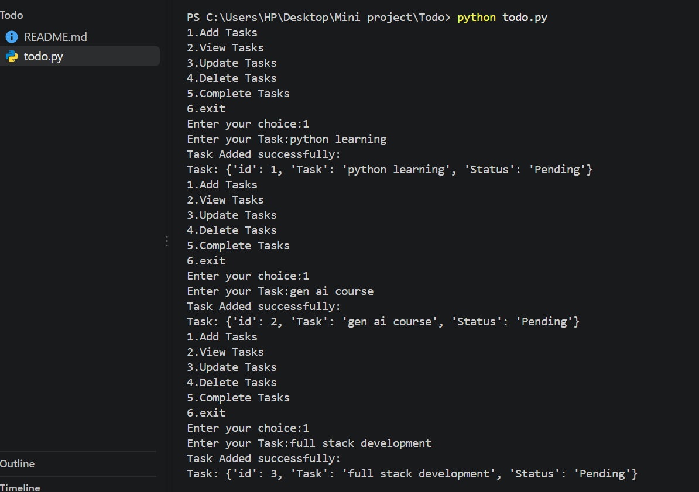
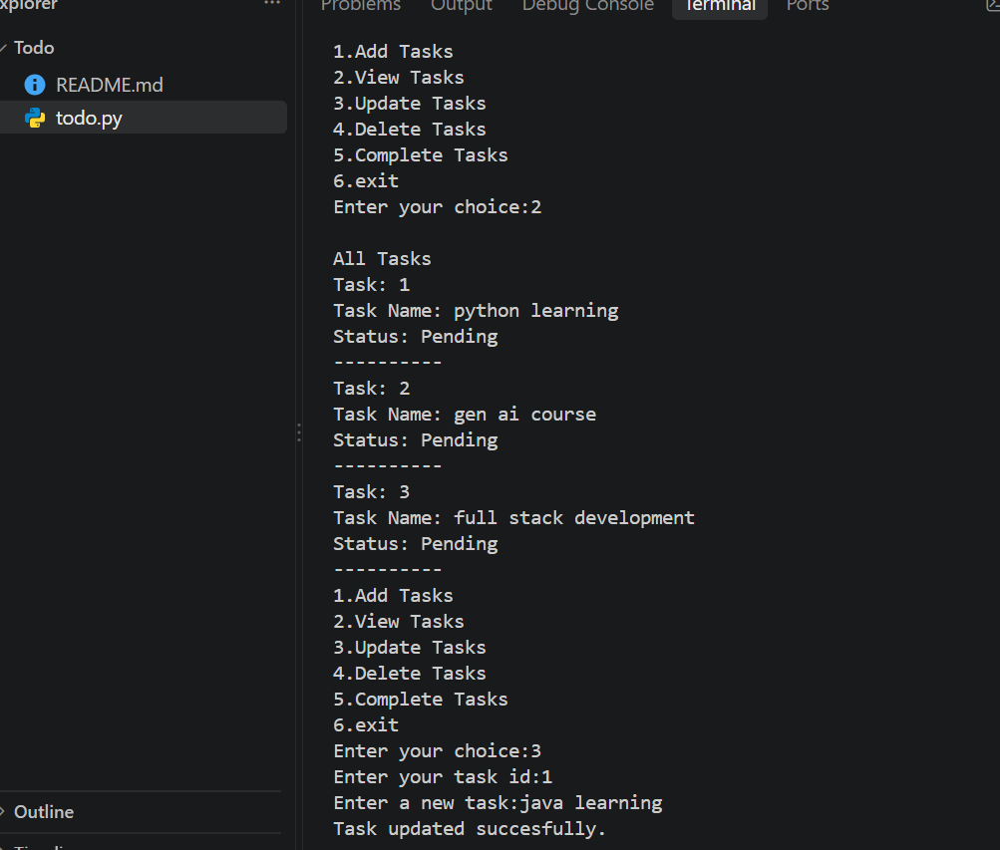
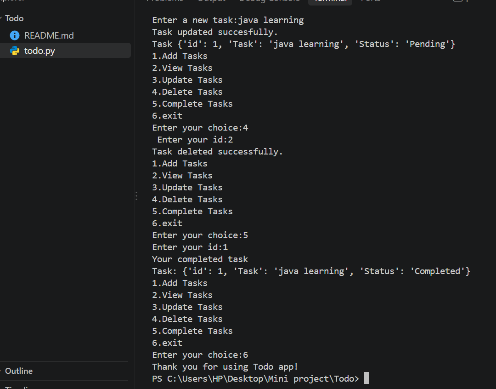

# Todo App

## 📌 Project Overview
The Todo App is a simple task management application that helps users organize their daily activities. Users can manage their tasks easily and keep track of their work.

## ✨ Features
- Add new tasks
- View the task list
- Mark tasks as completed
- Delete tasks
- Simple and user-friendly interface

## 🛠️ Technologies Used
- Python / HTML / CSS / JavaScript *(update this section based on your project)*
  
## 🚀 How to Run
1. Download or clone this repository.
2. Open the project folder in your code editor.
3. Run the application using the appropriate command for your project.

## 🎯 Project Objective
The objective of this project is to practice programming concepts and build a simple application for managing daily tasks.

## 👩‍💻 Author
Sandhiya
## Output Screenshots

